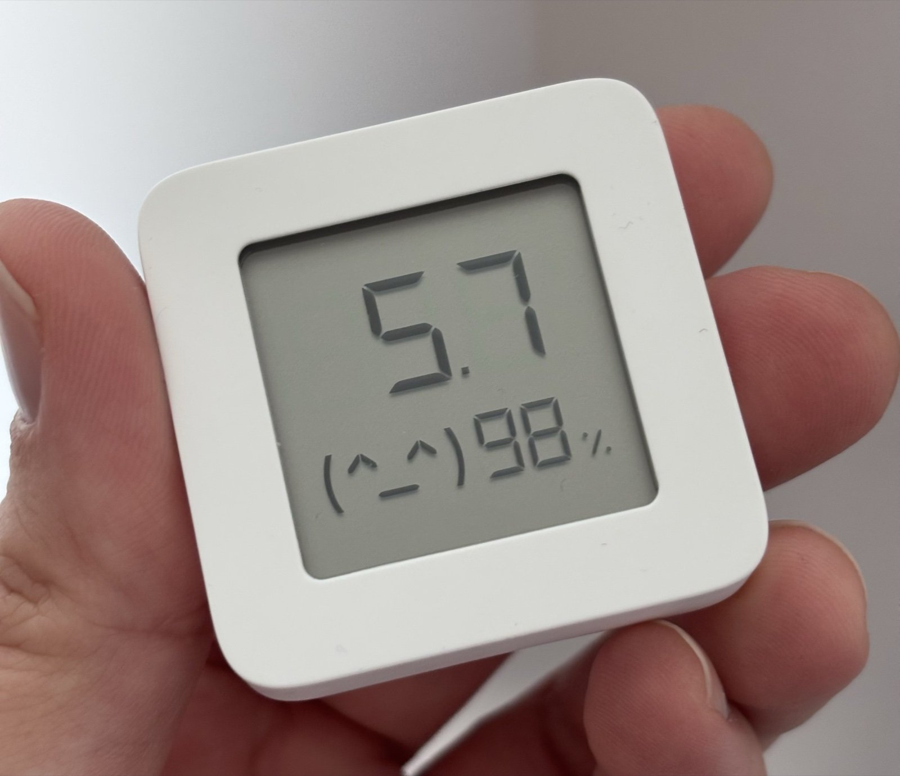

# Xiaomi LYWSD03MMC → solar meter

Turn a cheap Xiaomi LYWSD03MMC humidity monitor into a small live solar display for Home Assistant.

<p align="center">
  
</p>

- **Big number:** current PV production in **kW** (`5.7`)
- **Small number:** how much of it you use at home right now, in **%** (`98 %`)
- **Face:** gets happier the more of your own energy you use `(^_^)`

It's handy in the kitchen: one glance tells you whether it's a good moment to run the dishwasher or the washing machine.

No ESP32 and no soldering. Home Assistant talks to the thermometer over the Bluetooth it already has (a Raspberry Pi's built-in Bluetooth works fine).

---

## What you need

- Xiaomi Mi Temperature and Humidity Monitor 2 (**LYWSD03MMC**)
- Home Assistant with a working [Bluetooth integration](https://www.home-assistant.io/integrations/bluetooth/) whose adapter can make **connections**. A local adapter is the tested setup. ESPHome Bluetooth proxies with active connections should work too but haven't been tested.
- Sensors for PV production and grid export (any inverter integration will do)

## 1. Flash the pvvx firmware

The stock firmware can't show your own values. The [pvvx ATC_MiThermometer](https://github.com/pvvx/ATC_MiThermometer) custom firmware can, and you flash it over the air from the browser.

1. Open the **[Telink Flasher](https://pvvx.github.io/ATC_MiThermometer/TelinkMiFlasher.html)** in Chrome or Edge on a computer with Bluetooth.
2. Click **Connect** and select your thermometer (`LYWSD03MMC`).
3. Click **Do Activation** and wait for *Login successful*. The page shows the hardware and firmware version.
4. Under *Custom Firmware* select **ATC_v59.bin** (or the latest version) and click **Start Flashing**.

Mine was **hardware B1.4, stock firmware 1.0.0_0130**. It flashed directly, without going through the original firmware first. Other hardware revisions or newer stock firmware may need extra steps, so check the [pvvx README](https://github.com/pvvx/ATC_MiThermometer#readme) if yours behaves differently.

After flashing, write down the thermometer's **MAC address** (`A4:C1:38:…`). You'll need it below.

## 2. Install the `pvvx_display` component

### HACS (custom repository)

1. HACS → ⋮ → **Custom repositories** → add `https://github.com/jozefpis/xiaomi-LYWSD03MMC-to-solar-meter`, type **Integration**
2. Install **PVVX Display**

### Manual

Copy `custom_components/pvvx_display/` into your Home Assistant `config/custom_components/` folder.

### Enable it

Add this line to `configuration.yaml` and restart Home Assistant:

```yaml
pvvx_display:
```

## 3. Test it

**Developer tools → Actions**, switch to YAML mode:

```yaml
action: pvvx_display.show
data:
  address: "A4:C1:38:XX:XX:XX"
  big: 5.7
  small: 98
  percent: true
  happy: true
  bracket: true
  validity: 65535
```

The display should change within a few seconds.

## 4. Self-consumption sensor

Self-consumption % = (production − export) / production. See [`examples/template_sensors.yaml`](examples/template_sensors.yaml). Just replace the entity IDs with your inverter and grid meter sensors.

## 5. Automation

See [`examples/automations.yaml`](examples/automations.yaml):

- sends the values every **3 min** when someone is near the display (motion sensor + person at home), otherwise every **8 min**
- sends immediately at the first production in the morning and after an HA restart
- after sunset (or 10 min with no production) shows **zeros and stops connecting** until the next morning

---

## Service reference: `pvvx_display.show`

| Field | Description |
|---|---|
| `address` | MAC address of the thermometer (required) |
| `big` | Big number, one decimal place, −99.5 … 1999.5 |
| `small` | Small number, whole number, −9 … 99 |
| `validity` | Seconds the display keeps your value instead of its own reading. **65535 = permanently** |
| `unit` | Symbol next to the big number: `none`, `deg_c`, `deg_f`, `minus`, `lowdash`, `lines`, `deg_ghe`, `deg_e` |
| `percent` | Show `%` next to the small number |
| `battery` | Show the battery icon |
| `happy` / `sad` / `bracket` | Combine into faces (see below) |

| happy | sad | bracket | Face |
|:-:|:-:|:-:|---|
| ✓ | | ✓ | `(^_^)` |
| ✓ | | | `^_^` |
| ✓ | ✓ | | `Δ△Δ` |
| | ✓ | | `-∧-` |
| | ✓ | ✓ | `(-∧-)` |

## Tips and gotchas

- **The display keeps flipping back to temperature/humidity?** Use `validity: 65535`. Shorter values (even 900 s) make it alternate between your values and its own reading. In pvvx firmware 4.4+, 65535 means "show only external data until reboot". Downside: if HA stops sending, the display stays frozen on the last value.
- **There's no kW/W unit on the LCD.** Send kilowatts (`4.6`), which fits the big field nicely and looks just like the original temperature.
- **The big field officially goes up to 1999.5**, but in practice very large values showed garbage on my unit. Normal PV values (0–15 kW) are fine.
- **The small field shows `Hi` at 100**, so the component caps it at 99.
- **Battery:** every update means one BLE connection. One per minute drains a CR2032 in a few months. Every 3–8 min during the day plus no updates at night is a good compromise.
- One write at a time: the component serializes connections, because many BLE adapters can't handle parallel ones.
- Error `not in Bluetooth range (or not connectable)`: move the thermometer closer to the adapter or check that your adapter supports active connections.

## How it works

The component connects via Home Assistant's Bluetooth stack (`bleak-retry-connector`), writes one 8-byte frame to characteristic `0x1F1F` without response and disconnects immediately:

```
[0]   0x22
[1:3] big number   int16 LE, value × 10
[3:5] small number int16 LE
[5:7] validity     uint16 LE, seconds
[7]   flags        bit0 happy, bit1 sad, bit2 bracket, bit3 %, bit4 battery, bits5-7 unit
```

This is the same frame the ESPHome [`pvvx_mithermometer`](https://esphome.io/components/display/pvvx_mithermometer.html) display component uses, just sent directly from Home Assistant.

## Credits

- [pvvx/ATC_MiThermometer](https://github.com/pvvx/ATC_MiThermometer) for the firmware and the flasher, which make all of this possible
- ESPHome `pvvx_mithermometer` component, used as a reference for the display protocol

## License

MIT
